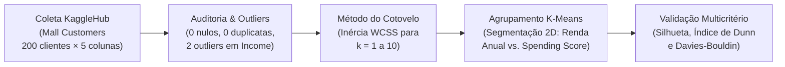
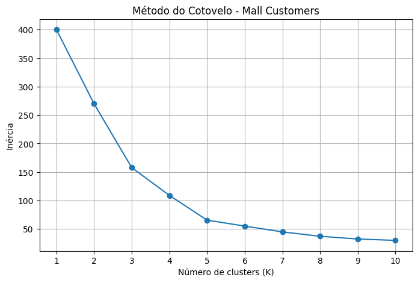
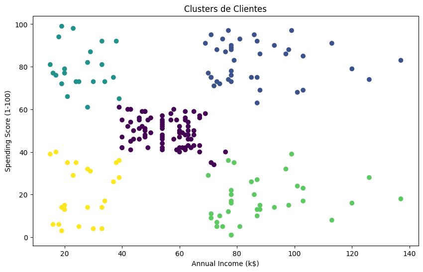
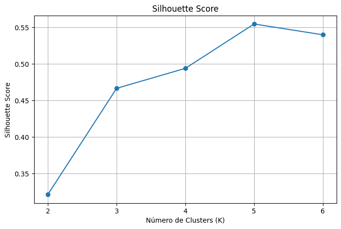
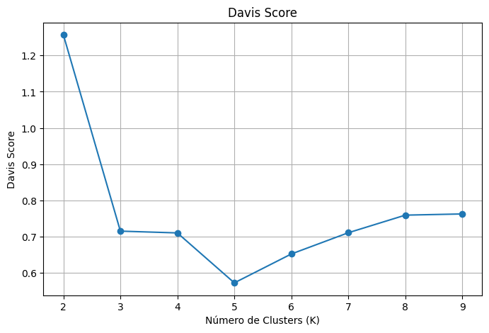
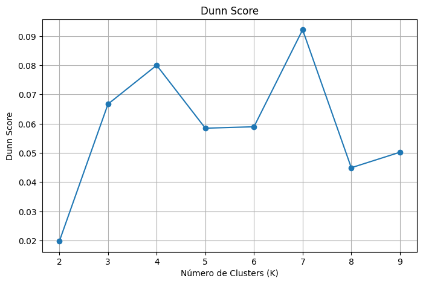
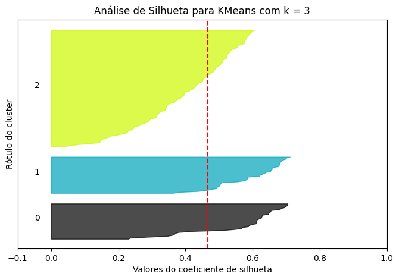
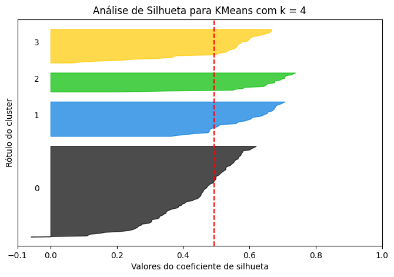
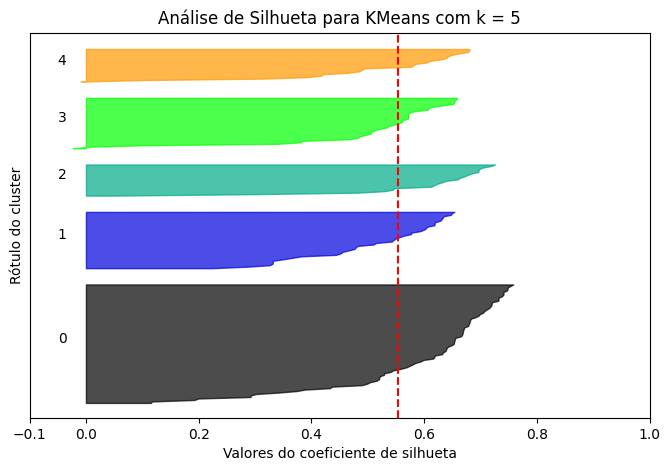
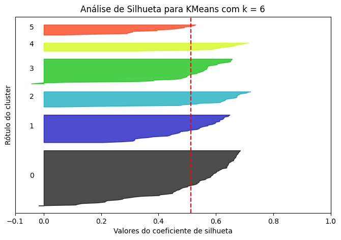

# Segmentação de Clientes e Avaliação de Clusters — Mall Customers (K-Means)


Projeto acadêmico da disciplina de **Modelos Descritivos** (Especialização em Engenharia e Análise de Dados — **CESAR School**), focado na segmentação não supervisionada de clientes de um shopping center (**Mall Customers**) e na avaliação quantitativa do número ideal de agrupamentos ($k$) utilizando múltiplas métricas de validação interna.

O notebook [`colab_mall_customers_kaggle.ipynb`](./colab_mall_customers_kaggle.ipynb) realiza a auditoria de qualidade e *outliers*, aplica o algoritmo **K-Means**, investiga a curva de inércia (**Método do Cotovelo**) e compara três índices formais de qualidade de clusterização: **Coeficiente de Silhueta**, **Índice de Dunn** e **Índice de Davies-Bouldin**.

---

## Sumário

1. [Visão Geral e Fluxo Metodológico](#1-visão-geral-e-fluxo-metodológico)
2. [Conjunto de Dados e Inspeção de Qualidade](#2-conjunto-de-dados-e-inspeção-de-qualidade)
3. [Escolha de $k$ pelo Método do Cotovelo e Segmentação K-Means](#3-escolha-de-k-pelo-método-do-cotovelo-e-segmentação-k-means)
4. [Validação Interna de Clusters: Silhueta, Dunn e Davies-Bouldin](#4-validação-interna-de-clusters-silhueta-dunn-e-davies-bouldin)
5. [Análise dos Perfis de Silhueta ($k=3$ a $k=6$)](#5-análise-dos-perfis-de-silhueta-k3-a-k6)
6. [Conclusão e Interpretação de Negócio](#6-conclusão-e-interpretação-de-negócio)
7. [Estrutura do Repositório](#7-estrutura-do-repositório)
8. [Como Executar](#8-como-executar)
9. [Créditos](#9-créditos)

---

## 1. Visão Geral e Fluxo Metodológico



---

## 2. Conjunto de Dados e Inspeção de Qualidade

O dataset [Customer Segmentation Tutorial in Python](https://www.kaggle.com/datasets/vjchoudhary7/customer-segmentation-tutorial-in-python) reúne **200 clientes** sem valores ausentes (`0` nulos) e sem registros duplicados (`0` duplicatas):

| Variável | Tipo | Média ± Desvio-Padrão | Mín — Mediana — Máx | Outliers (IQR) | Descrição |
| :--- | :-: | :-: | :-: | :-: | :--- |
| `CustomerID` | `int64` | 100,5 ± 57,9 | 1 — 100,5 — 200 | — | Identificador sequencial do cliente |
| `Gender` | `object` | — | `Female` / `Male` | — | Gênero declarado pelo cliente |
| `Age` | `int64` | 38,85 ± 13,97 | 18 — 36,0 — 70 | 0 | Idade em anos |
| **`Annual Income (k$)`** | `int64` | **60,56 ± 26,26** | **15 — 61,5 — 137** | **2** *(IDs 199 e 200: 137 k\$)* | Renda anual estimada em milhares de dólares |
| **`Spending Score (1-100)`** | `int64` | **50,20 ± 25,82** | **1 — 50,0 — 99** | 0 | Pontuação de comportamento/frequência de gasto |

---

## 3. Escolha de $k$ pelo Método do Cotovelo e Segmentação K-Means

Avaliando a soma dos quadrados intra-cluster (**Inércia / WCSS**) para $k \in [1, 10]$ nas variáveis `Annual Income (k$)` e `Spending Score (1-100)`, observa-se uma inflexão nítida em **$k = 5$**, onde a adição de novos centroides passa a produzir ganhos marginais reduzidos e os 5 perfis socioeconômicos e comportamentais tornam-se claramente distintos:

| Método do Cotovelo (Inércia vs. $k$) | Segmentação K-Means ($k = 5$) e Centroides |
| :-: | :-: |
|  |  |

---

## 4. Validação Interna de Clusters: Silhueta, Dunn e Davies-Bouldin

Para validar objetivamente a escolha de $k$ sem depender apenas da inspeção visual do cotovelo, foram calculadas três métricas clássicas de avaliação interna para $k \in [2, 9]$:

1. **Coeficiente de Silhueta (*Silhouette Score* — Maior é melhor, $[-1, +1]$):** Mede o quão próximo cada ponto está do seu próprio cluster em comparação ao cluster vizinho mais próximo. Atinge seu **máximo global em $k = 5$ ($0{,}554$)**.
2. **Índice de Davies-Bouldin (Menor é melhor, $\ge 0$):** Avalia a razão média entre a dispersão intra-cluster e a distância entre centroides. Atinge seu **mínimo global (melhor resultado) em $k = 5$ ($0{,}573$)**.
3. **Índice de Dunn (Maior é melhor, $> 0$):** Razão entre a menor distância inter-cluster e o maior diâmetro intra-cluster (sensível a pontos de borda). Apresenta picos em $k = 4$ ($0{,}0800$) e $k = 7$ ($0{,}0921$).

### 4.1. Tabela Comparativa das Métricas por Número de Clusters ($k$)

| Nº de Clusters ($k$) | Coeficiente de Silhueta $\uparrow$ | Índice de Davies-Bouldin $\downarrow$ | Índice de Dunn $\uparrow$ | Síntese da Avaliação |
| :-: | :-: | :-: | :-: | :--- |
| $k = 2$ | ~0,29 | 1,257 | 0,0197 | Sub-segmentação severa (alta dispersão interna) |
| $k = 3$ | 0,468 | 0,715 | 0,0667 | Separação intermediária |
| $k = 4$ | 0,494 | 0,710 | 0,0800 | Boa compacidade, mas funde dois perfis distintos |
| **$k = 5$ *(Ótimo)* ** | **0,554 (Melhor)** | **0,573 (Melhor)** | 0,0584 | **Consenso ótimo entre Cotovelo, Silhueta e Davies-Bouldin** |
| $k = 6$ | 0,513 | 0,652 | 0,0589 | Início de sobre-segmentação do grupo superior |
| $k = 7$ | 0,502 | 0,711 | **0,0921 (Pico)** | Fragmentação de grupos de alta renda |
| $k = 8$ | 0,496 | 0,759 | 0,0449 | Queda de coesão geral |
| $k = 9$ | ~0,46 | 0,763 | 0,0502 | Excesso de clusters |

### 4.2. Curvas das Métricas de Validação ($k = 2$ a $9$)

| Coeficiente de Silhueta $\uparrow$ | Índice de Davies-Bouldin $\downarrow$ | Índice de Dunn $\uparrow$ |
| :-: | :-: | :-: |
|  |  |  |

---

## 5. Análise dos Perfis de Silhueta ($k=3$ a $k=6$)

Os diagramas de silhueta por amostra demonstram por que **$k = 5$** oferece a partição mais equilibrada: todos os 5 agrupamentos ultrapassam confortavelmente a linha tracejada da média global ($0{,}554$) e apresentam espessuras homogêneas sem valores negativos expressivos:

| $k = 3$ (Silhueta = $0{,}468$) | $k = 4$ (Silhueta = $0{,}494$) |
| :-: | :-: |
|  |  |

| **$k = 5$ (Silhueta = $0{,}554$ — Ótimo)** | $k = 6$ (Silhueta = $0{,}513$) |
| :-: | :-: |
|  |  |

---

## 6. Conclusão e Interpretação de Negócio

A convergência entre o **Método do Cotovelo**, o **Coeficiente de Silhueta ($0{,}554$)** e o **Índice de Davies-Bouldin ($0{,}573$)** confirma **$k = 5$** como a estrutura natural do plano `Annual Income × Spending Score`, revelando 5 arquétipos clássicos de consumidores:
1. **Baixa Renda e Baixo Gasto:** Clientes conservadores com orçamento restrito.
2. **Baixa Renda e Alto Gasto:** Consumidores impulsivos ou altamente engajados com promoções.
3. **Renda Média e Gasto Médio:** Público central e mais numeroso do shopping (cluster intermediário).
4. **Alta Renda e Baixo Gasto:** Clientes de alto poder aquisitivo, porém cautelosos/pouco convertidos (grande oportunidade para ações de fidelização).
5. **Alta Renda e Alto Gasto (*Clientes VIP / Target*):** Segmento premium de maior retorno para campanhas exclusivas.

---

## 7. Estrutura do Repositório

```text
├── assets/                                     # Gráficos do método do cotovelo, K-Means e métricas de validação
│   ├── indice_davies_bouldin_por_k.png
│   ├── indice_dunn_por_k.png
│   ├── indice_silhueta_por_k.png
│   ├── metodo_cotovelo_inercia.png
│   ├── perfil_silhueta_k3.png
│   ├── perfil_silhueta_k4.png
│   ├── perfil_silhueta_k5.png
│   ├── perfil_silhueta_k6.png
│   └── segmentacao_clientes_k5.png
├── colab_mall_customers_kaggle.ipynb           # Notebook completo com código, métricas e visualizações
├── .gitignore                                  # Regras de exclusão de arquivos locais e caches
├── requirements.txt                            # Dependências Python
└── README.md                                   # Documentação detalhada do projeto
```

---

## 8. Como Executar

Recomendado: **Python 3.10** ou superior.

1. Clone este repositório e acesse a pasta:
   ```bash
   git clone https://github.com/pepsbr/analise-mall-customers-exploracao-modelos-descritivos.git
   cd analise-mall-customers-exploracao-modelos-descritivos
   ```
2. Instale as dependências:
   ```bash
   python -m pip install -r requirements.txt
   ```
3. Abra `colab_mall_customers_kaggle.ipynb` no Jupyter ou Google Colab e execute as células em ordem:
   ```bash
   jupyter notebook colab_mall_customers_kaggle.ipynb
   ```
   > **Nota:** A primeira célula obtém automaticamente o dataset via `kagglehub`.

---

## 9. Créditos

- **Autor:** Pedro Paulo Sant'Anna Belo Ramos — Especialização em Engenharia e Análise de Dados (*CESAR School*)
- **Módulo:** Modelos Descritivos — Avaliação de Clusters (dados publicados por V. J. Choudhary no Kaggle).
